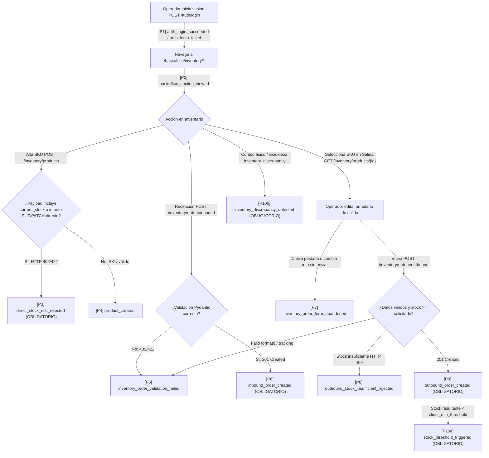

# Plan Maestro de Diseño de Telemetría — TrackFlow (`docs/telemetry/telemetry-plan.md`)

**Compañía:** TrackFlow (Almacenes y Logística B2B/B2C en Estados Unidos y España)  
**Unidad responsable:** TrackFlow Tech (Zaragoza · Los Ángeles)  
**Versión del contrato:** `1.0.0`  
**Esquema ejecutable asociado:** [`./event-schemas.json`](./event-schemas.json) (JSON Schema `draft-07`)  
**Alcance del diseño:** `20` eventos estructurados (`5` obligatorios del `trackflow-BRIEFING.md` + `15` oportunidades técnicas y de negocio identificadas en `services/api` y `uis/backoffice`) distribuidos en **6 categorías**.

---

## 1. Contexto de Dominio, Entidades Oficiales y Restricciones Innegociables

En TrackFlow, **el inventario es literalmente el negocio**: gestionamos el almacenamiento y la preparación de pedidos para marcas de e-commerce (`fashion`, `electronics`, `cosmetics`) en dos centros operativos desconectados históricamente — **Los Ángeles (EE. UU.)** y **Zaragoza (España)**. Este plan responde al RFI de Operaciones y Dirección estableciendo contratos inmutables que alimentarán tanto el **Dashboard Operativo de Almacén de Ana Whitfield** como el **Dashboard Ejecutivo Global de Thomas Harry / Daniel Espinoza** y las alertas comerciales de **Miguel Torres**.

### 1.1. Entidades Canónicas e Identificadores (`trackflow-BRIEFING.md`)

Para garantizar agregaciones limpias por almacén, por marca cliente y por país en los futuros pipelines de datos, toda la telemetría adopta los nombres e identificadores canónicos del briefing:

| Entidad del Briefing | Significado en TrackFlow | Representación actual en código (`services/api` / `uis/backoffice`) | Normalización obligatoria en Telemetría (`properties`) |
|---|---|---|---|
| `Product` | SKU perteneciente a una única marca cliente con categoría (`fashion`, `electronics`, `cosmetics`) | Modelo `SKU` (`sku.sku`, `sku.category`, `sku.client_name`) | `product_id` (código SKU, ej. `"CLT-SNK-W-42"`) + `product_category` (`"fashion" \| "electronics" \| "cosmetics"`) |
| `InboundOrder` | Recepción física de mercancía enviada por un cliente marca a un almacén | Modelo `StockEntry` (`POST /inventory/orders/inbound`) | `order_id` (`"INB-<id>"`), `reference` (albarán/PO del cliente), `quantity` (`> 0`) |
| `OutboundOrder` | Preparación (*picking*) y despacho de mercancía o baja auditada | Modelo `StockExit` (`POST /inventory/orders/outbound`) | `order_id` (`"OUT-<id>"`), `exit_type` (`"dispatch" \| "loss"`), `quantity` (`> 0`) |
| `warehouse` | Sede física de almacenamiento (Los Ángeles o Zaragoza) | Literal `"LA"` o `"ZGZ"` en base de datos | **`"los_angeles"`** (cuando BD = `"LA"`) o **`"zaragoza"`** (cuando BD = `"ZGZ"`), acompañado de `country` (`"US"` o `"ES"`) |
| `client` | Marca B2B propietaria exclusiva del SKU | `SKU.client_name` (ej. `"PureStep Footwear"`) | `client_id` en *snake_case* determinista (ej. `"purestep_footwear"`, `"soundwave_electronics"`) |

### 1.2. Restricciones de Negocio y Privacidad del Dominio
1. **Inmutabilidad directa del stock:** El stock jamás se edita como columna; solo varía mediante `InboundOrder` o `OutboundOrder` trazables a un `userId` autenticado. Cualquier intento directo de mutar stock es rechazado y auditado (`direct_stock_edit_rejected`).
2. **Propiedad exclusiva por cliente:** Cada `product_id` pertenece a un único `client_id` dentro de cada `warehouse`; nunca se mezcla stock entre marcas.
3. **Frontera estricta con Última Milla (Cero PII de destinatarios B2C):** Los eventos de inventario describen operaciones internas de almacén. **Queda terminantemente prohibido incluir datos personales del consumidor final** (nombre, dirección de entrega, teléfono o email del destinatario) **así como datos contractuales o de tracking del transportista** dentro de `properties` de los eventos de inventario.

---

## 2. Fase 1 — Mapeo de Flujos y Catálogo Exhaustivo de Oportunidades de Datos

### 2.1. Mapeo Punta a Punta del Flujo de Gestión de Inventario (10 Puntos de Instrumentación)

A continuación se traza el recorrido completo de un operador autenticado en `uis/backoffice` interactuando con `services/api`, señalando los **10 puntos exactos de captura** (`[P1]` a `[P10]`):

### 2.2. Catálogo Maestro de Eventos (20 Eventos en 6 Categorías — Regla de Oro Aplicada)

Cada evento existe únicamente porque responde una hipótesis concreta y habilita una decisión accionable. Ningún evento se captura "por si acaso" sin dueño ni decisión asociada.

| # | `event_type` (`entidad_acción`) | Clasificación | Categoría | Origen de Captura | Regla de Oro: *"Capturamos `[event_type]` porque necesitamos saber `[hipótesis]`, lo que nos permite tomar la decisión `[decisión]`."* |
|---|---|---|---|---|---|
| 1 | `inbound_order_created` | **Obligatorio (`BRIEFING`)** | Negocio · Inventario | Backend (`POST /inventory/orders/inbound`) | Capturamos `inbound_order_created` porque necesitamos saber **cuánto volumen de mercancía entra por cliente, categoría y almacén en cada franja horaria**, lo que nos permite tomar la decisión de **planificar la capacidad de estanterías y asignar turnos de personal de muelle en Los Ángeles y Zaragoza (Ana Whitfield)**. |
| 2 | `outbound_order_created` | **Obligatorio (`BRIEFING`)** | Negocio · Inventario | Backend (`POST /inventory/orders/outbound`) | Capturamos `outbound_order_created` porque necesitamos saber **cuántos pedidos se preparan y despachan por cliente y almacén, distinguiendo despachos reales de bajas por merma (`loss`)**, lo que nos permite tomar la decisión de **detectar cuellos de botella en picking antes de incumplir el SLA de entrega comprometido (Ana Whitfield / Thomas Harry)**. |
| 3 | `stock_threshold_triggered` | **Obligatorio (`BRIEFING`)** | Negocio · Inventario | Backend (`routers/inventory.py` tras `StockExit`) | Capturamos `stock_threshold_triggered` porque necesitamos saber **con qué frecuencia y velocidad el stock disponible de un SKU cae por debajo del umbral mínimo configurado para su marca cliente**, lo que nos permite tomar la decisión de **alertar proactivamente al cliente y a su Account Manager para coordinar reposición antes de sufrir un quiebre de stock (Miguel Torres)**. |
| 4 | `direct_stock_edit_rejected` | **Obligatorio (`BRIEFING`)** | Negocio · Inventario / Auditoría | Backend (rechazo `extra="forbid"` de `current_stock` o `PATCH/PUT` directo sobre `/inventory/products*`) | Capturamos `direct_stock_edit_rejected` porque necesitamos saber **si operarios o scripts internos intentan modificar unidades de stock fuera de una orden trazable**, lo que nos permite tomar la decisión de **reforzar la capacitación operativa, corregir integraciones heredadas o restringir permisos en el almacén donde ocurra (Ana Whitfield / Andrés Kim)**. |
| 5 | `inventory_discrepancy_detected` | **Obligatorio (`BRIEFING`)** | Negocio · Inventario | Backend (auditoría de conteo cíclico / alta de incidencia `inventory_discrepancy`) | Capturamos `inventory_discrepancy_detected` porque necesitamos saber **en qué SKUs, categorías y almacenes diverge más el stock físico real respecto al stock calculado por el sistema**, lo que nos permite tomar la decisión de **priorizar conteos cíclicos semanales y revisar procesos de recepción/picking en las referencias con mayor tasa de descuadre (Ana Whitfield)**. |
| 6 | `product_created` | Oportunidad identificada | Negocio · Inventario | Backend (`POST /inventory/products`) | Capturamos `product_created` porque necesitamos saber **a qué ritmo incorporan nuevas referencias (`SKU`) nuestras marcas cliente en cada país**, lo que nos permite tomar la decisión de **dimensionar ubicaciones de picking dedicadas y evaluar la expansión comercial de cuentas activas (Miguel Torres / Ana Whitfield)**. |
| 7 | `inventory_order_validation_failed` | Oportunidad identificada | Negocio · Inventario / Calidad | Backend (`RequestValidationError` en `/inventory/orders/*` y `/inventory/products`) | Capturamos `inventory_order_validation_failed` porque necesitamos saber **qué productos, almacenes y campos (`reference`, `quantity`, reglas de salida) acumulan más errores de validación al registrar órdenes**, lo que nos permite tomar la decisión de **simplificar las ayudas contextuales del formulario en el backoffice y corregir plantillas operativas defectuosas (Andrés Kim)**. |
| 8 | `outbound_stock_insufficient_rejected` | Oportunidad identificada | Negocio · Inventario | Backend (`HTTP 400 Insufficient stock` en `POST /inventory/orders/outbound`) | Capturamos `outbound_stock_insufficient_rejected` porque necesitamos saber **cuánta demanda real de salida se rechaza por falta de unidades disponibles en un almacén concreto cuando el otro almacén sí podría tener stock**, lo que nos permite tomar la decisión de **rebalancear inventario entre Los Ángeles y Zaragoza o ajustar el stock de seguridad del cliente (Ana Whitfield / Miguel Torres)**. |
| 9 | `inventory_order_form_abandoned` | Oportunidad identificada | Navegación y Embudos UX | Frontend (`InboundOrderPage` y `OutboundOrderForm`) | Capturamos `inventory_order_form_abandoned` porque necesitamos saber **en qué paso o campo abandonan los operarios el registro de una orden de entrada o salida después de haber empezado a rellenarla**, lo que nos permite tomar la decisión de **rediseñar los campos con mayor fricción o pre-rellenar valores por defecto según el almacén del operario (TrackFlow Tech)**. |
| 10 | `incident_created` | Oportunidad identificada | Negocio · Operaciones e Incidencias | Backend (`POST /api/incidents`) | Capturamos `incident_created` porque necesitamos saber **el volumen de incidencias operativas entrantes por categoría (`lost_parcel`, `carrier_issue`, `returns_issue`), origen y sede**, lo que nos permite tomar la decisión de **reasignar agentes de Atención al Cliente y escalar penalizaciones con proveedores problemáticos (Valentina Cruz / Carlos Vega)**. |
| 11 | `incident_status_transitioned` | Oportunidad identificada | Negocio · Operaciones e Incidencias | Backend (`PATCH /api/incidents/{id}/status`) | Capturamos `incident_status_transitioned` porque necesitamos saber **cuánto tiempo permanece cada incidencia en `open` e `in_progress` antes de resolverse o descartarse**, lo que nos permite tomar la decisión de **establecer objetivos reales de MTTR por sede y desbloquear colas estancadas (Valentina Cruz / Thomas Harry)**. |
| 12 | `supplier_rate_updated` | Oportunidad identificada | Negocio · Proveedores | Backend (`PATCH /api/suppliers/{id}/rate` y `/status`) | Capturamos `supplier_rate_updated` porque necesitamos saber **cómo evolucionan las tarifas por envío y suspensiones de proveedores en EE. UU. (`USD`) y España (`EUR`)**, lo que nos permite tomar la decisión de **renegociar contratos logísticos anuales o desviar volumen a transportistas alternativos cuando suben los costes unitarios (Carlos Vega)**. |
| 13 | `auth_login_succeeded` | Oportunidad identificada | Autenticación y Seguridad | Backend (`POST /auth/login` → `200`) | Capturamos `auth_login_succeeded` porque necesitamos saber **cuántos operadores activos inician turno por franja horaria y rol**, lo que nos permite tomar la decisión de **dimensionar licencias, ventanas de mantenimiento sin impacto y auditorías de cuentas inactivas (Andrés Kim)**. |
| 14 | `auth_login_failed` | Oportunidad identificada | Autenticación y Seguridad | Backend (`POST /auth/login` → `401`) | Capturamos `auth_login_failed` porque necesitamos saber **cuántos intentos de acceso fallan al día y si provienen de olvidos legítimos de contraseña o ráfagas de fuerza bruta sobre cuentas concretas**, lo que nos permite tomar la decisión de **activar *rate limiting* por subred, bloquear IPs atacantes o mejorar el flujo de recuperación de clave (Andrés Kim)**. |
| 15 | `session_expired` | Oportunidad identificada | Autenticación y Seguridad | Frontend (`fetchWithAuth` / `inventoryRequest` al recibir `401`) | Capturamos `session_expired` porque necesitamos saber **con qué frecuencia les caduca el JWT de 30 minutos a los operarios de almacén en mitad de una tarea activa**, lo que nos permite tomar la decisión de **ajustar `ACCESS_TOKEN_EXPIRE_MINUTES` o implementar *refresh tokens* silenciosos para no interrumpir el trabajo en muelle (Andrés Kim)**. |
| 16 | `api_latency_recorded` | Oportunidad identificada | Rendimiento y Caché | Backend (`TimingMiddleware` en `services/api/main.py`) | Capturamos `api_latency_recorded` porque necesitamos saber **qué rutas superan el umbral p95 de latencia en producción y cuál es la tasa real de aciertos (`hit`/`miss`) de `TTLCache`**, lo que nos permite tomar la decisión de **ajustar TTLs, añadir índices SQL en Supabase o escalar réplicas de FastAPI antes de degradar la UX (Andrés Kim)**. |
| 17 | `page_load_measured` | Oportunidad identificada | Rendimiento Frontend | Frontend (`uis/backoffice` Web Vitals / cambio de ruta) | Capturamos `page_load_measured` porque necesitamos saber **el tiempo real de carga e hidratación (LCP / TTFB / montaje) que experimentan los operarios en sus dispositivos de almacén (tablets/PCs en LA y ZGZ)**, lo que nos permite tomar la decisión de **aplicar *code-splitting* adicional o pre-carga de rutas críticas donde la red Wi-Fi de nave industrial sea lenta (TrackFlow Tech)**. |
| 18 | `frontend_error_uncaught` | Oportunidad identificada | Errores de Sistema | Frontend (`window.onerror` / `unhandledrejection` / `ErrorBoundary`) | Capturamos `frontend_error_uncaught` porque necesitamos saber **qué fallos de renderizado o caídas de conexión de red ocurren silenciosamente en los navegadores de los operarios sin llegar al backend**, lo que nos permite tomar la decisión de **desplegar *hotfixes* inmediatos sin depender de avisos manuales por WhatsApp (Andrés Kim)**. |
| 19 | `backend_storage_failed` | Oportunidad identificada | Errores de Sistema | Backend (`OSError` TinyDB, `sqlite3.Error`, `OperationalError` PostgreSQL) | Capturamos `backend_storage_failed` porque necesitamos saber **cuándo falla una operación de lectura/escritura contra Supabase PostgreSQL, SQLite o TinyDB antes de que escale a caída total**, lo que nos permite tomar la decisión de **activar *failover*, revisar el *connection pooler* (puerto `6543`) o escalar almacenamiento de inmediato (Andrés Kim)**. |
| 20 | `backoffice_section_viewed` | Oportunidad identificada | Navegación y Adopción | Frontend (`Sidebar` / transición de ruta en `uis/backoffice`) | Capturamos `backoffice_section_viewed` porque necesitamos saber **qué módulos del backoffice visitan realmente los operadores en su jornada y qué vistas apenas reciben tráfico**, lo que nos permite tomar la decisión de **priorizar la hoja de ruta del próximo sprint en las pantallas de mayor uso diario y retirar o rediseñar secciones muertas (Andrés Kim / Producto)**. |

---

## 3. Fase 2 — Diseño del Event Envelope, Allowlists y Protección de PII

### 3.1. Estructura Estándar del Event Envelope (Obligatoria en el 100 % de Eventos)

Todo evento emitido por `services/api` o `uis/backoffice` debe ajustarse exactamente al siguiente sobre raíz (`additionalProperties: false`):

| Campo | Tipo | Obligatorio | Formato / Ejemplo | Propósito Técnico |
|---|---|:---:|---|---|
| `eventId` | `string` | Sí | UUID v4 (`"9b1deb4d-3b7d-4bad-9bdd-2b0d7b3dcb6d"`) | Clave primaria de deduplicación idempotente en ingesta (*at-least-once delivery*). |
| `timestamp` | `string` | Sí | ISO 8601 UTC (`"2026-11-25T20:15:30.412Z"`) | Instante exacto en que ocurrió el hecho, siempre en UTC para cruzar LA (`UTC-8`) y ZGZ (`UTC+1`) sin ambigüedad horaria. |
| `sessionId` | `string` | Sí | UUID v4 de sesión web o `"srv_batch_<id>"` | Agrupa la secuencia completa de acciones de una sesión de trabajo o corrida interna. |
| `userId` | `string \| null` | Sí | `user_uuid` opaco (`"550e8400-..."` o `"usr_1"`) o `null` | Identificador pseudonimizado del operador autenticado (jamás email ni nombre completo); `null` únicamente en eventos previos a autenticarse (`auth_login_failed`). |
| `event_type` | `string` | Sí | `snake_case` `entidad_acción` (`"inbound_order_created"`) | Discriminador canónico validado contra `event-schemas.json`. |
| `schemaVersion` | `string` | Sí | SemVer `"1.0.0"` | Permite evolucionar `properties` en futuros sprints sin romper consumidores aguas abajo. |
| `requestId` | `string` | Sí | UUID v4 (`X-Request-ID`) | Correlación distribuida entre evento de UI, petición HTTP en FastAPI y líneas de log del servidor. |
| `properties` | `object` | Sí | Objeto validado por allowlist cerrado | Atributos específicos del evento; cualquier clave fuera del allowlist es rechazada (`additionalProperties: false`). |

---

### 3.2. Especificación Detallada de Esquemas, Allowlists y Sanitización PII por Evento

> **Regla global de Allowlist:** En el colector de telemetría y en [`event-schemas.json`](./event-schemas.json), cada esquema declara `"additionalProperties": false` tanto en el *envelope* como dentro de `properties`. Cualquier atributo no listado explícitamente en el `Allowlist` de ese `event_type` es eliminado o rechazado antes de persistirse.

#### 1. `inbound_order_created` *(Obligatorio — BRIEFING)*
- **Descripción e instrumentación:** Emitido en `services/api/routers/inventory.py` (`create_inbound_order`) inmediatamente después de `session.commit()` al registrar un `StockEntry`.
- **Allowlist `properties`:** `["warehouse", "country", "client_id", "product_id", "product_category", "quantity", "order_id", "reference", "resulting_stock"]`
- **Propiedades:**
  | Propiedad | Tipo | Req. | Descripción |
  |---|---|:---:|---|
  | `warehouse` | `"los_angeles" \| "zaragoza"` | Sí | Almacén receptor normalizado desde `"LA"` / `"ZGZ"`. |
  | `country` | `"US" \| "ES"` | Sí | País derivado del almacén para agregaciones ejecutivas transfronterizas. |
  | `client_id` | `string` | Sí | Slug canónico de la marca dueña del SKU (ej. `"purestep_footwear"`). |
  | `product_id` | `string` | Sí | Código SKU recibido (ej. `"CLT-SNK-W-42"`). |
  | `product_category` | `"fashion" \| "electronics" \| "cosmetics"` | Sí | Categoría de producto del catálogo. |
  | `quantity` | `integer (>= 1)` | Sí | Unidades físicas recibidas en la orden de entrada. |
  | `order_id` | `string` | Sí | Identificador interno prefijado (`"INB-104"`). |
  | `reference` | `string` | Sí | Código de albarán u orden de compra B2B (ej. `"PO-2026-0412"`). |
  | `resulting_stock` | `integer (>= 0)` | Sí | Stock neto resultante del SKU en ese almacén tras contabilizar la entrada. |
- **PII / Sanitización:** No contiene PII. `userId` en el envelope usa `user_uuid` opaco; `reference` se trunca a 64 caracteres alfanuméricos eliminando cualquier texto libre accidental.

#### 2. `outbound_order_created` *(Obligatorio — BRIEFING)*
- **Descripción e instrumentación:** Emitido en `services/api/routers/inventory.py` (`create_outbound_order`) tras `session.commit()` de un `StockExit`.
- **Allowlist `properties`:** `["warehouse", "country", "client_id", "product_id", "product_category", "quantity", "order_id", "exit_reason", "resulting_stock"]`
- **Propiedades:**
  | Propiedad | Tipo | Req. | Descripción |
  |---|---|:---:|---|
  | `warehouse` | `"los_angeles" \| "zaragoza"` | Sí | Almacén desde donde sale el stock. |
  | `country` | `"US" \| "ES"` | Sí | País de la operación (`US` o `ES`). |
  | `client_id` | `string` | Sí | Identificador canónico de la marca cliente propietaria. |
  | `product_id` | `string` | Sí | Código SKU despachado o dado de baja. |
  | `product_category` | `"fashion" \| "electronics" \| "cosmetics"` | Sí | Categoría del SKU. |
  | `quantity` | `integer (>= 1)` | Sí | Unidades descontadas del inventario. |
  | `order_id` | `string` | Sí | Identificador interno prefijado (`"OUT-209"`). |
  | `exit_reason` | `"dispatch" \| "loss"` | Sí | Motivo de salida: preparación a pedido (`dispatch`) o merma/daño (`loss`). |
  | `resulting_stock` | `integer (>= 0)` | Sí | Stock disponible restante en ese almacén tras el movimiento. |
- **PII / Sanitización:** **Sanitización estricta de dominio:** Aunque `StockExit` en base de datos posee `tracking_number` para última milla, **se excluyen deliberadamente `tracking_number`, nombre de transportista y cualquier dato del consumidor destinatario** del allowlist para cumplir la restricción de negocio n.º 3 del `BRIEFING`.

#### 3. `stock_threshold_triggered` *(Obligatorio — BRIEFING)*
- **Descripción e instrumentación:** Emitido en `routers/inventory.py` cuando, tras confirmar una salida, `resulting_stock` cruza hacia abajo el umbral mínimo del cliente (`threshold_quantity`, p. ej. `50` uds. alerta `low` o `10` uds. alerta `critical`).
- **Allowlist `properties`:** `["warehouse", "country", "client_id", "product_id", "product_category", "quantity", "previous_stock", "threshold_quantity", "severity", "trigger_order_id"]`
- **Propiedades:**
  | Propiedad | Tipo | Req. | Descripción |
  |---|---|:---:|---|
  | `warehouse` | `"los_angeles" \| "zaragoza"` | Sí | Almacén afectado por el riesgo de rotura. |
  | `country` | `"US" \| "ES"` | Sí | País del almacén. |
  | `client_id` | `string` | Sí | Marca cliente a notificar por Comercial. |
  | `product_id` | `string` | Sí | Código SKU en alerta. |
  | `product_category` | `"fashion" \| "electronics" \| "cosmetics"` | Sí | Categoría del SKU. |
  | `quantity` | `integer (>= 0)` | Sí | Stock actual remanente del SKU en ese almacén al dispararse la alerta (`0` si hubo quiebre total). |
  | `previous_stock` | `integer (>= 0)` | Sí | Stock previo inmediatamente antes del descuento que cruzó el umbral. |
  | `threshold_quantity` | `integer (>= 1)` | Sí | Umbral mínimo configurado para ese SKU/cliente (ej. `10` o `50`). |
  | `severity` | `"low" \| "critical" \| "stockout"` | Sí | Nivel operativo (`low` ≤ umbral preventivo, `critical` ≤ 10, `stockout` == 0). |
  | `trigger_order_id` | `string` | Sí | Orden de salida (`"OUT-..."`) que provocó el cruce del umbral. |
- **PII / Sanitización:** Sin PII (identificadores puramente corporativos B2B y de catálogo).

#### 4. `direct_stock_edit_rejected` *(Obligatorio — BRIEFING)*
- **Descripción e instrumentación:** Emitido en `services/api/main.py` (`handle_request_validation_error` cuando un payload hacia `/inventory/products*` incluye campos prohibidos como `current_stock` o `stock_by_warehouse` rechazados por `extra="forbid"`, o ante peticiones `PUT`/`PATCH`/`DELETE` directas sobre recursos de stock fuera de `/inventory/orders/*`).
- **Allowlist `properties`:** `["warehouse", "country", "client_id", "product_id", "product_category", "quantity", "attempted_endpoint", "http_method", "rejected_field", "actor_role"]`
- **Propiedades:**
  | Propiedad | Tipo | Req. | Descripción |
  |---|---|:---:|---|
  | `warehouse` | `"los_angeles" \| "zaragoza" \| "unknown"` | Sí | Almacén objetivo extraído del payload o del SKU; `"unknown"` si el payload malformado no lo especificó. |
  | `country` | `"US" \| "ES" \| "unknown"` | Sí | País asociado al almacén objetivo. |
  | `client_id` | `string` | Sí | Marca cliente del SKU objetivo o `"unknown"` si fue un alta rechazada sin cliente válido. |
  | `product_id` | `string` | Sí | Código SKU sobre el que se intentó forzar el stock (o `"unknown"`). |
  | `product_category` | `"fashion" \| "electronics" \| "cosmetics" \| "unknown"` | Sí | Categoría del SKU involucrado. |
  | `quantity` | `integer` | Sí | Valor de stock directo que el usuario intentó inyectar (`0` si no era numérico). |
  | `attempted_endpoint` | `string` | Sí | Ruta invocada (ej. `"/inventory/products"`). |
  | `http_method` | `"POST" \| "PUT" \| "PATCH" \| "DELETE"` | Sí | Verbo HTTP empleado en el intento. |
  | `rejected_field` | `string` | Sí | Nombre del atributo bloqueado (ej. `"current_stock"`). |
  | `actor_role` | `"admin" \| "manager" \| "user" \| "anonymous"` | Sí | Rol del usuario autenticado que realizó el intento. |
- **PII / Sanitización:** El usuario queda trazado únicamente mediante `userId` (`user_uuid`) en el envelope y su `actor_role`, sin volcar cabeceras `Authorization` ni el cuerpo crudo de la petición.

#### 5. `inventory_discrepancy_detected` *(Obligatorio — BRIEFING)*
- **Descripción e instrumentación:** Emitido cuando un conteo cíclico de almacén o el registro de una incidencia de categoría `inventory_discrepancy` reporta divergencia entre `system_stock` y `actual_stock`.
- **Allowlist `properties`:** `["warehouse", "country", "client_id", "product_id", "product_category", "quantity", "system_stock", "actual_stock", "discrepancy_direction", "detection_source", "incident_id"]`
- **Propiedades:**
  | Propiedad | Tipo | Req. | Descripción |
  |---|---|:---:|---|
  | `warehouse` | `"los_angeles" \| "zaragoza"` | Sí | Almacén donde se detectó el descuadre físico. |
  | `country` | `"US" \| "ES"` | Sí | País de la sede. |
  | `client_id` | `string` | Sí | Marca cliente propietaria del SKU auditado. |
  | `product_id` | `string` | Sí | Código SKU con descuadre. |
  | `product_category` | `"fashion" \| "electronics" \| "cosmetics"` | Sí | Categoría del SKU. |
  | `quantity` | `integer (>= 1)` | Sí | Valor absoluto de unidades de diferencia (`abs(actual_stock - system_stock)`). |
  | `system_stock` | `integer (>= 0)` | Sí | Unidades esperadas según la suma `entradas - salidas` en Supabase. |
  | `actual_stock` | `integer (>= 0)` | Sí | Unidades físicas contadas en estantería. |
  | `discrepancy_direction` | `"shortage" \| "surplus"` | Sí | `"shortage"` si faltan unidades físicas (`actual < system`); `"surplus"` si sobran. |
  | `detection_source` | `"cycle_count" \| "picking_check" \| "inbound_audit" \| "incident_report"` | Sí | Proceso operativo que destapó la discrepancia. |
  | `incident_id` | `integer \| null` | No | ID de la incidencia vinculada en SQLite si se abrió ticket operativo. |
- **PII / Sanitización:** Sin PII ni textos libres de notas internas que puedan incluir nombres propios de operarios.

#### 6. `product_created` *(Oportunidad identificada — Negocio · Inventario)*
- **Descripción e instrumentación:** Emitido en `POST /inventory/products` (`create_product`) al dar de alta un nuevo SKU con stock inicial `0`.
- **Allowlist `properties`:** `["warehouse", "country", "client_id", "product_id", "product_category", "quantity", "sku_db_id"]`
- **Propiedades:** `warehouse` (`"los_angeles" \| "zaragoza"`, req), `country` (`"US" \| "ES"`, req), `client_id` (`string`, req), `product_id` (`string`, req), `product_category` (`"fashion" \| "electronics" \| "cosmetics"`, req), `quantity` (`integer`, req — siempre `0` al nacer), `sku_db_id` (`integer`, req).
- **PII / Sanitización:** Sin PII.

#### 7. `inventory_order_validation_failed` *(Oportunidad identificada — Negocio · Inventario)*
- **Descripción e instrumentación:** Emitido cuando `POST /inventory/orders/inbound`, `POST /inventory/orders/outbound` o `POST /inventory/products` falla con `400` / `409` / `422` por reglas de esquema (ej. falta `reference`, `quantity <= 0`, SKU duplicado `409`, o inconsistencia de campos requeridos según `exit_type`).
- **Allowlist `properties`:** `["warehouse", "product_id", "order_movement_type", "failed_field", "error_code", "http_status"]`
- **Propiedades:** `warehouse` (`"los_angeles" \| "zaragoza" \| "unknown"`, req), `product_id` (`string`, req — SKU o `"unknown"`), `order_movement_type` (`"inbound" \| "outbound" \| "product_catalog"`, req), `failed_field` (`string`, req — ej. `"quantity"`, `"reference"`, `"tracking_number_rule"`), `error_code` (`string`, req — código tipificado sin volcar el valor rechazado), `http_status` (`integer`, req — `400`, `409` o `422`).
- **PII / Sanitización:** Nunca se incluye el valor crudo escrito por el usuario en `failed_field` (podría haber pegado por error un dato personal o número de seguimiento en el campo equivocado); solo se emite el nombre del campo y el código de regla.

#### 8. `outbound_stock_insufficient_rejected` *(Oportunidad identificada — Negocio · Inventario)*
- **Descripción e instrumentación:** Emitido en `create_outbound_order` justo antes de lanzar `HTTPException(400, "Insufficient stock...")` cuando `payload.quantity > available`.
- **Allowlist `properties`:** `["warehouse", "country", "client_id", "product_id", "product_category", "quantity", "available_stock", "deficit_quantity", "other_warehouse_stock"]`
- **Propiedades:** `warehouse` (req), `country` (req), `client_id` (req), `product_id` (req), `product_category` (req), `quantity` (`integer`, req — unidades solicitadas), `available_stock` (`integer`, req — unidades disponibles en ese almacén), `deficit_quantity` (`integer`, req — `quantity - available_stock`), `other_warehouse_stock` (`integer`, req — stock disponible en la sede hermana para evaluar si el inventario está mal distribuido entre países).
- **PII / Sanitización:** Sin PII ni datos de transportista/destinatario.

#### 9. `inventory_order_form_abandoned` *(Oportunidad identificada — Navegación y Embudos UX)*
- **Descripción e instrumentación:** Emitido en `uis/backoffice` (`inbound/page.tsx` y `outbound/page.tsx`) al desmontar el componente o dispararse `visibilitychange: hidden` cuando el usuario modificó al menos un campo (`fields_touched_count >= 1`) pero no completó el envío exitoso.
- **Allowlist `properties`:** `["order_movement_type", "warehouse", "fields_touched_count", "last_field_interacted", "had_validation_error", "time_spent_ms"]`
- **Propiedades:** `order_movement_type` (`"inbound" \| "outbound"`, req), `warehouse` (`"los_angeles" \| "zaragoza"`, req), `fields_touched_count` (`integer >= 1`, req), `last_field_interacted` (`string`, req — nombre del input, nunca su contenido), `had_validation_error` (`boolean`, req), `time_spent_ms` (`integer >= 0`, req).
- **PII / Sanitización:** Solo registra metadatos estructurales de interacción (nombres de campos y tiempos), jamás el texto tecleado.

#### 10. `incident_created` *(Oportunidad identificada — Operaciones e Incidencias)*
- **Descripción e instrumentación:** Emitido en `POST /api/incidents` (`create_new_incident`) al persistir una incidencia en SQLite.
- **Allowlist `properties`:** `["incident_id", "category", "origin", "branch", "country", "initial_status", "description_length"]`
- **Propiedades:** `incident_id` (`integer`, req), `category` (`"lost_parcel" \| "carrier_issue" \| "delivery_failure" \| "returns_issue" \| "inventory_discrepancy"`, req), `origin` (`"customer" \| "branch" \| "internal"`, req), `branch` (`"central" \| "la_warehouse" \| "la_office" \| "zaragoza_warehouse" \| "zaragoza_office"`, req), `country` (`"US" \| "ES"`, req), `initial_status` (`"open" \| "in_progress" \| "resolved" \| "discarded"`, req), `description_length` (`integer >= 5`, req).
- **PII / Sanitización:** **Sanitización crítica:** `title` y `description` pueden contener nombres, teléfonos o direcciones pegados manualmente por un agente de atención al cliente; por eso **se excluyen `title` y `description` del evento** y solo se captura `description_length` y las dimensiones categóricas cerradas.

#### 11. `incident_status_transitioned` *(Oportunidad identificada — Operaciones e Incidencias)*
- **Descripción e instrumentación:** Emitido en `PATCH /api/incidents/{incident_id}/status` (`patch_incident_status`).
- **Allowlist `properties`:** `["incident_id", "category", "branch", "previous_status", "new_status", "time_in_previous_status_sec", "is_terminal"]`
- **Propiedades:** `incident_id` (`integer`, req), `category` (`string`, req), `branch` (`string`, req), `previous_status` (`string`, req), `new_status` (`string`, req), `time_in_previous_status_sec` (`number >= 0`, req — diferencia entre `now` y el `updated_at` previo), `is_terminal` (`boolean`, req — `true` si `new_status` es `"resolved"` o `"discarded"`).
- **PII / Sanitización:** Sin PII.

#### 12. `supplier_rate_updated` *(Oportunidad identificada — Negocio · Proveedores)*
- **Descripción e instrumentación:** Emitido en `PATCH /api/suppliers/{id}/rate` y `PATCH /api/suppliers/{id}/status`.
- **Allowlist `properties`:** `["supplier_id", "country", "currency", "previous_rate", "new_rate", "rate_delta_pct", "supplier_status"]`
- **Propiedades:** `supplier_id` (`integer`, req), `country` (`string`, req), `currency` (`"EUR" \| "USD" \| "OTHER"`, req), `previous_rate` (`number > 0`, req), `new_rate` (`number > 0`, req), `rate_delta_pct` (`number`, req — variación porcentual redondeada a 2 decimales), `supplier_status` (`"active" \| "suspended"`, req).
- **PII / Sanitización:** Se excluyen `contact_email` y `notes` del proveedor para no propagar correos de contacto personal a los almacenes analíticos.

#### 13. `auth_login_succeeded` *(Oportunidad identificada — Autenticación y Seguridad)*
- **Descripción e instrumentación:** Emitido en `POST /auth/login` tras validar credenciales y emitir el JWT (`userId` poblado con `user_uuid`).
- **Allowlist `properties`:** `["actor_role", "auth_method"]`
- **Propiedades:** `actor_role` (`"admin" \| "manager" \| "user"`, req), `auth_method` (`"password_form"`, req).
- **PII / Sanitización:** **Nunca incluye `email`, `password`, `hashed_password` ni el `access_token` emitido.**

#### 14. `auth_login_failed` *(Oportunidad identificada — Autenticación y Seguridad)*
- **Descripción e instrumentación:** Emitido en `POST /auth/login` cuando falla la autenticación con `HTTP 401` (`userId = null` en el envelope).
- **Allowlist `properties`:** `["failure_reason", "email_domain", "email_hash_sha256", "ip_subnet_masked"]`
- **Propiedades:** `failure_reason` (`"unknown_account" \| "invalid_password" \| "inactive_account"`, req — solo visible en telemetría interna de seguridad, jamás expuesto en la respuesta HTTP para mantener anti-enumeración), `email_domain` (`string`, req — ej. `"trackflow.com"` o `"invalid"`), `email_hash_sha256` (`string`, req — hash HMAC-SHA256 con *salt* secreto del email normalizado para agrupar ráfagas contra una misma cuenta sin almacenar el email en claro), `ip_subnet_masked` (`string`, req — IPv4 truncada a `/24`, ej. `"192.168.1.0/24"`, o IPv6 `/48`).
- **PII / Sanitización:** **Contiene PII potencial en origen (email e IP), sanitizada antes de emitirse:** el email jamás se guarda en texto plano (solo hash irreversible + dominio) y el último octeto de la IP se enmascara a `0` cumpliendo minimización RGPD/CCPA.

#### 15. `session_expired` *(Oportunidad identificada — Autenticación y Seguridad)*
- **Descripción e instrumentación:** Emitido en `uis/backoffice/src/utils/api.ts` (`fetchWithAuth`) y `src/lib/inventory.ts` cuando una petición autenticada recibe `HTTP 401`, limpia `localStorage` y redirige a `/login`.
- **Allowlist `properties`:** `["interrupted_route", "failed_api_path", "session_age_sec"]`
- **Propiedades:** `interrupted_route` (`string`, req — ruta limpia sin query params sensibles, ej. `"/backoffice/inventory/orders/outbound"`), `failed_api_path` (`string`, req — ej. `"/inventory/orders/outbound"`), `session_age_sec` (`integer \| null`, op — segundos transcurridos desde el login si consta en memoria).
- **PII / Sanitización:** Se eliminan todos los *query strings* (`?...`) de `interrupted_route` y jamás se adjunta el token expirado.

#### 16. `api_latency_recorded` *(Oportunidad identificada — Rendimiento y Caché)*
- **Descripción e instrumentación:** Emitido asíncronamente desde `TimingMiddleware` (`services/api/main.py`) según la política de muestreo definida en la Fase 3.
- **Allowlist `properties`:** `["http_method", "route_template", "status_code", "duration_ms", "cache_status", "warehouse_filter"]`
- **Propiedades:** `http_method` (`"GET" \| "POST" \| "PUT" \| "PATCH" \| "DELETE"`, req), `route_template` (`string`, req — ruta parametrizada como `"/inventory/products/{id}"` para evitar explosión de cardinalidad), `status_code` (`integer`, req), `duration_ms` (`number >= 0`, req), `cache_status` (`"hit" \| "miss" \| "bypass"`, req), `warehouse_filter` (`"los_angeles" \| "zaragoza" \| "all" \| null`, op).
- **PII / Sanitización:** Usa plantillas de ruta (`route_template`) sin parámetros de búsqueda ni payloads.

#### 17. `page_load_measured` *(Oportunidad identificada — Rendimiento Frontend)*
- **Descripción e instrumentación:** Emitido en `uis/backoffice` mediante `PerformanceObserver` / `useReportWebVitals` al completar la carga e hidratación de una pantalla.
- **Allowlist `properties`:** `["route_path", "lcp_ms", "ttfb_ms", "hydration_ms", "viewport_category", "connection_effective_type"]`
- **Propiedades:** `route_path` (`string`, req — ruta limpia, ej. `"/"`, `"/backoffice/inventory/products"`), `lcp_ms` (`number >= 0`, req), `ttfb_ms` (`number >= 0`, req), `hydration_ms` (`number >= 0`, op), `viewport_category` (`"mobile" \| "tablet" \| "desktop"`, req), `connection_effective_type` (`"4g" \| "3g" \| "2g" \| "slow-2g" \| "unknown"`, op).
- **PII / Sanitización:** Sin `User-Agent` completo ni IP para evitar *fingerprinting* de dispositivo.

#### 18. `frontend_error_uncaught` *(Oportunidad identificada — Errores de Sistema)*
- **Descripción e instrumentación:** Emitido por un manejador global (`ErrorBoundary` + `unhandledrejection`) en `uis/backoffice`.
- **Allowlist `properties`:** `["route_path", "component_name", "error_name", "sanitized_message", "is_network_failure", "occurrences_suppressed"]`
- **Propiedades:** `route_path` (`string`, req), `component_name` (`string`, req), `error_name` (`string`, req — ej. `"TypeError"`, `"InventoryApiError"`), `sanitized_message` (`string`, req — máx. 200 caracteres tras filtro sanitizador), `is_network_failure` (`boolean`, req), `occurrences_suppressed` (`integer >= 0`, req — duplicados agrupados durante la ventana de *throttle*).
- **PII / Sanitización:** **Sanitización obligatoria por expresiones regulares:** antes de poblar `sanitized_message` y `route_path`, el cliente reemplaza cualquier patrón de correo (`[\w.+-]+@[\w-]+\.[\w.-]+` → `"[REDACTED_EMAIL]"`), JWT (`eyJ[A-Za-z0-9_-]+\.[A-Za-z0-9_-]+\.[A-Za-z0-9_-]+` → `"[REDACTED_JWT]"`) y parámetros `?token=...` (usados en `/reset-password`) por `"[REDACTED_TOKEN]"`.

#### 19. `backend_storage_failed` *(Oportunidad identificada — Errores de Sistema)*
- **Descripción e instrumentación:** Emitido en los bloques `except (OSError, sqlite3.Error, OperationalError)` de `services/api` cuando falla TinyDB, SQLite o el motor SQLModel de Supabase.
- **Allowlist `properties`:** `["storage_engine", "operation", "route_template", "exception_class", "http_status_returned"]`
- **Propiedades:** `storage_engine` (`"supabase_postgresql" \| "sqlite_incidents" \| "tinydb_local"`, req), `operation` (`"read" \| "write" \| "delete" \| "schema_init"`, req), `route_template` (`string`, req), `exception_class` (`string`, req — ej. `"OperationalError"`, `"OSError"`), `http_status_returned` (`integer`, req — `500` o `503`).
- **PII / Sanitización:** **Jamás captura el string crudo de la excepción (`str(exc)`)**, ya que las excepciones de `psycopg2` / SQLModel pueden filtrar el host o usuario de `DATABASE_URL` o parámetros SQL con datos de usuario.

#### 20. `backoffice_section_viewed` *(Oportunidad identificada — Navegación y Adopción)*
- **Descripción e instrumentación:** Emitido en `uis/backoffice/src/components/Sidebar.tsx` y el layout autenticado al navegar entre secciones operativas.
- **Allowlist `properties`:** `["section_id", "route_path", "previous_section_id", "dwell_time_previous_ms", "actor_role"]`
- **Propiedades:** `section_id` (`string`, req — ej. `"resumen"`, `"inventario_skus"`, `"orden_entrada"`, `"orden_salida"`, `"historial_ordenes"`, `"incidencias"`, `"proveedores"`, `"mi_perfil"`), `route_path` (`string`, req), `previous_section_id` (`string \| null`, op), `dwell_time_previous_ms` (`integer \| null`, op — permanencia efectiva en la vista previa), `actor_role` (`"admin" \| "manager" \| "user"`, req).
- **PII / Sanitización:** Sin PII; rutas parametrizadas sin tokens ni queries.

---

## 4. Fase 3 — Estrategia de Entrega (Stream vs. Batch), Throttle/Debounce y Exclusiones

### 4.1. Matriz de Entrega: Stream vs. Batch Justificada por Urgencia de Negocio

| `event_type` | Modo de Entrega | Ventana / Latencia Objetivo | Justificación Operativa o de Negocio (No por preferencia técnica) |
|---|:---:|---|---|
| `stock_threshold_triggered` | **Stream** | `< 5 segundos` | Si un SKU estrella de una marca entra en quiebre o umbral crítico durante una campaña, Miguel Torres (Comercial) y el cliente necesitan recibir la alerta de inmediato para pausar anuncios o activar reposición urgente antes de vender unidades inexistentes. |
| `direct_stock_edit_rejected` | **Stream** | `< 5 segundos` | Un intento repetido de alterar stock saltándose órdenes puede indicar una credencial comprometida, un script descontrolado o una mala praxis activa en almacén; requiere alerta inmediata en el canal operativo de tecnología/almacén. |
| `inventory_discrepancy_detected` | **Stream** | `< 10 segundos` | Mientras el SKU presenta un descuadre físico no conciliado, los operarios de picking pueden dirigirse a una estantería vacía; Ana Whitfield necesita bloquear o auditar esa ubicación en el mismo turno en que se detecta. |
| `outbound_stock_insufficient_rejected` | **Stream** | `< 10 segundos` | Confirma que en ese instante se está frenando preparación de pedidos en muelle por falta de stock disponible; permite desviar la preparación o priorizar la descarga de un tráiler entrante ya en patio. |
| `auth_login_failed` | **Stream** | `< 5 segundos` | Un ataque de *credential stuffing* o fuerza bruta ocurre en segundos; procesarlo en lotes horarios llegaría cuando la cuenta ya fue comprometida o bloqueada. |
| `backend_storage_failed` | **Stream** | `< 5 segundos` | Reemplaza el actual "aviso por WhatsApp" que sufre Andrés Kim cuando cae la conexión con Supabase o se corrompe un archivo local; exige *paging* automático inmediato al equipo de guardia en Zaragoza. |
| `frontend_error_uncaught` | **Stream** | `< 15 segundos` | Si un despliegue nuevo rompe la pantalla de órdenes de salida en los navegadores de Los Ángeles (cuando Zaragoza está fuera de horario), la alerta en tiempo real permite hacer *rollback* en minutos. |
| `inbound_order_created` | **Batch** | Cada `15 minutos` | La planificación de capacidad de estanterías, turnos de muelle de Ana y facturación logística B2B por recepción se analiza por hora, turno y semana; procesar en micro-lotes de 15 min reduce costes de escritura manteniendo frescura de dashboard más que suficiente. |
| `outbound_order_created` | **Batch** | Cada `15 minutos` | Alimenta las curvas de ritmo de picking por turno de Ana y la comparativa EE. UU. vs. España de Thomas; una agregación cada 15 minutos detecta desviaciones de SLA matutinas/vespertinas sin sobrecargar la base transaccional en picos de despacho. |
| `product_created` | **Batch** | Cada `1 hora` | El alta de nuevos SKUs en catálogo es una métrica estructural de crecimiento comercial por cuenta B2B cuyas decisiones (asignación de pasillos y revisiones mensuales de cuenta) son diarias o semanales. |
| `inventory_order_validation_failed` | **Batch** | Cada `1 hora` | Sirve al equipo de producto e ingeniería para identificar qué campos confunden a los operarios y priorizar mejoras de UX en el siguiente sprint; no requiere reacción en vivo. |
| `inventory_order_form_abandoned` | **Batch** | Diario (`24 h`) | El análisis de embudos de abandono de formularios requiere volumen estadístico acumulado de varios días para distinguir interrupciones puntuales de muelle frente a problemas reales de diseño. |
| `incident_created` | **Batch** *(o micro-batch `5 min`)* | Cada `5 minutos` | La gestión individual del ticket ya vive en la base operativa SQLite; a nivel analítico de telemetría, consolidar cada 5 minutos basta para refrescar volúmenes por sede y categoría sin duplicar un bus transaccional. |
| `incident_status_transitioned` | **Batch** | Cada `15 minutos` | Alimenta el cálculo de MTTR promedio y cuellos de botella por sede para Valentina Cruz y el reporte semanal de dirección. |
| `supplier_rate_updated` | **Batch** | Diario (`24 h`) | Las tarifas de transportistas cambian con baja frecuencia y se auditan en revisiones financieras semanales/mensuales de margen por envío. |
| `auth_login_succeeded` | **Batch** | Cada `1 hora` | Se emplea para mapas de calor de concurrencia por turno (LA vs. ZGZ) y auditoría mensual de cuentas sin uso. |
| `session_expired` | **Batch** | Diario (`24 h`) | Métrica agregada de fricción de sesión para calibrar la duración del JWT; las decisiones de política de sesión se toman por revisión técnica semanal. |
| `api_latency_recorded` | **Batch** | Cada `5 minutos` | Se acumula en un *buffer* en memoria de FastAPI y se vuelca en lotes comprimidos cada 5 minutos (o cada 500 muestras) para calcular percentiles `p50/p95/p99` y *hit rate* de caché sin añadir I/O síncrona de red a cada request HTTP. |
| `page_load_measured` | **Batch** | Cada `15 minutos` | Las métricas RUM (LCP/TTFB) se envían mediante `navigator.sendBeacon` y se procesan en lotes para evaluar regresiones tras despliegues. |
| `backoffice_section_viewed` | **Batch** | Diario (`24 h`) | Alimenta mapas de adopción de producto para priorización de backlog trimestral/quincenal; carece de urgencia en tiempo real. |

---

### 4.2. Estrategia de Throttle, Debounce y Muestreo para Eventos de Alta Frecuencia

Sin control de caudal, ciertos eventos pueden degradar la misma aplicación que intentan observar:

1. **`backoffice_section_viewed` — Debounce de `1,000 ms` en cliente:**
   - En `Sidebar.tsx`, varios ítems navegan entre anclas de una misma página (`#resumen`, `#almacenes`, `#envios`, `#clientes`). Si un operador hace clic rápido recorriendo el menú lateral, el cliente aplica un *debounce* de **`1,000 ms`**: solo se registra la vista si el usuario permanece al menos 1 segundo en la sección destino, descartando tránsitos efímeros.
2. **`stock_threshold_triggered` — Deduplicación por transición de estado (*Edge-Triggered Cooldown*):**
   - Si el SKU `CLT-SNK-W-42` tiene umbral `50` y cae de `52 → 48`, se emite `stock_threshold_triggered` (`severity: "low"`). Si diez minutos después otra salida lo baja de `48 → 45`, **no se vuelve a disparar la misma severidad `"low"`** (evitando bombardear por email al cliente y a Miguel en cada pedido). Solo vuelve a emitirse si: (a) escala a una severidad peor (`"critical"` ≤ 10 o `"stockout"` == 0), o (b) el stock se repuso por encima de `50` mediante una `InboundOrder` y posteriormente vuelve a cruzar el umbral hacia abajo.
3. **`frontend_error_uncaught` — Throttle por huella (`60 segundos`) con contador de supresión:**
   - Un fallo dentro de un efecto de React puede disparar cientos de excepciones idénticas por segundo. El SDK cliente calcula una huella `fingerprint = "${error_name}:${component_name}:${sanitized_message.slice(0,80)}"`, emite el primer evento de inmediato y silencia duplicados idénticos durante **`60 segundos`**, acumulando el total omitido en `occurrences_suppressed` para enviarlo en el siguiente corte sin perder visibilidad de magnitud.
4. **`api_latency_recorded` — Muestreo adaptativo estratificado (*Tail-Based Sampling*):**
   - Emitir un evento JSON completo por cada `GET` cacheado de `0.3 ms` multiplicaría por 10 el coste de CPU de la propia ruta. Se aplica muestreo determinista:
     - **`100 %` de captura** si `duration_ms >= 200.0` (peticiones lentas) o `status_code >= 400` (errores).
     - **`10 %` de muestreo aleatorio** en peticiones saludables rápidas (`status_code < 400` y `duration_ms < 200.0`), permitiendo estimar volumen total y *hit rate* multiplicando por el peso inverso (`sample_rate = 0.1`).
5. **`inventory_order_form_abandoned` — Disparo único por ciclo de montaje (`once-per-mount`):**
   - No se escucha cada pulsación `onChange` hacia la red; un `ref` booleano local marca `isDirty = true` en memoria y únicamente al desmontar la vista o recibir `pagehide` (si `isSubmitted === false`) se encola un único evento mediante `navigator.sendBeacon`.

---

### 4.3. Riesgos, Exclusiones y Eventos Considerados pero Descartados

#### A. Eventos candidatos evaluados y descartados deliberadamente
1. **`search_keystroke_typed` (pulsaciones en buscadores de SKUs, órdenes e incidencias):**
   - *Por qué se descartó:* Genera decenas de eventos por segundo mientras el operario escribe (`"C"`, `"CL"`, `"CLT..."`), dispara costes de ingesta, no habilita ninguna decisión operativa distinta y conlleva alto riesgo de capturar texto libre sensible pegado por error en la barra de búsqueda.
2. **`mouse_movement_tracked` / `scroll_depth_recorded` en el Backoffice:**
   - *Por qué se descartó:* Técnicas propias de *landing pages* B2C de marketing, inútiles en una herramienta operativa interna donde los operarios trabajan por tareas obligatorias; añaden peso al hilo principal de JavaScript y degradan el INP en equipos modestos de almacén.
3. **`carrier_parcel_delivered` y `recipient_address_updated` (eventos de reparto domiciliario):**
   - *Por qué se descartó:* Fuera del límite de contexto de este sistema según el `trackflow-BRIEFING.md` (Sección 6). Mezclar telemetría de almacén con telemetría de última milla acoplaría esquemas de dos dominios distintos e introduciría PII de consumidores finales en el *data lake* de inventario.
4. **`auth_token_validated` (cada ejecución exitosa de `Depends(get_current_user)`):**
   - *Por qué se descartó:* Se ejecuta en casi todas las peticiones privadas de la API; no aporta señal adicional frente a `auth_login_succeeded` + `backoffice_section_viewed` y duplicaría innecesariamente el volumen total del pipeline.
5. **`csv_row_validated` (un evento individual por cada fila inválida en `POST /api/incidents/analyze`):**
   - *Por qué se descartó:* Un único archivo CSV defectuoso de 10,000 filas generaría una tormenta instantánea de 10,000 eventos; si se requiere medir el uso del analizador en el futuro, debe hacerse con un único evento resumen por lote, jamás a nivel de fila.

#### B. Datos estrictamente excluidos por Privacidad, Seguridad o Coste
- **Credenciales y secretos de sesión:** Contraseñas en claro, `hashed_password` bcrypt, tokens JWT (`Authorization: Bearer ...`), tokens de recuperación de contraseña (`?token=...`) y claves API (`RESEND_API_KEY`, `DATABASE_URL`).
- **PII de consumidores finales B2C y contactos externos:** Nombres, direcciones postales, teléfonos, correos electrónicos de destinatarios de paquetes, números de seguimiento (`tracking_number`) asociados a domicilios particulares y `contact_email` de proveedores.
- **Identificadores personales directos de empleados:** En lugar del email corporativo o nombre completo (`name`, `phone`, `address` de `profiles`), la telemetría utiliza exclusivamente `userId = user_uuid` pseudonimizado; la tabla de correspondencia reside únicamente en la base de autenticación restringida a administradores.
- **Textos libres no estructurados:** Descripciones abiertas de incidencias (`description`), notas de proveedores (`notes`) y contenido de archivos CSV cargados.

---

## 5. Guía de Datos Semilla para la Instrumentación y Pipeline (Próximo Hito)

Para validar de punta a punta este plan en los siguientes proyectos del módulo (Captura → Almacenamiento → Reporte), el generador de semillas deberá cubrir como mínimo el escenario exigido por el `trackflow-BRIEFING.md`:

- **Catálogo (`Product`):** 10 SKUs distribuidos entre al menos 3 marcas cliente (`purestep_footwear`, `soundwave_electronics`, `glowlab_cosmetics`), cubriendo las 3 categorías (`fashion`, `electronics`, `cosmetics`) en ambos almacenes (`los_angeles` y `zaragoza`).
- **Movimientos:** Entre 16 y 20 eventos `inbound_order_created` y entre 16 y 20 eventos `outbound_order_created` repartidos entre EE. UU. y España.
- **Alertas y Auditoría:** Al menos **2 activaciones** de `stock_threshold_triggered` (ej. caída por debajo de `50` y caída crítica por debajo de `10`), **2 rechazos** de `direct_stock_edit_rejected` y **al menos 1 caso** documentado de `inventory_discrepancy_detected`, acompañados de eventos representativos de autenticación, navegación, latencia y errores para poblar todas las vistas analíticas.
